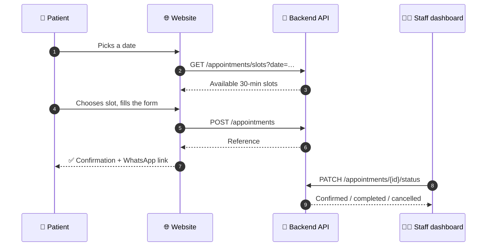

<div align="center">

# 🩺 Care Scan & Diagnostic Centre

### Official website of **Dr. M. M. Hussain** — Consultant Radiologist & Fetal Medicine Specialist

*"The care u can trust"* · Austin Town, Bengaluru

<br>


<br>

[**✨ Features**](#-features) ·
[**🚀 Quick Start**](#-quick-start) ·
[**🗂 Structure**](#-project-structure) ·
[**🔌 API**](#-backend-api-contract) ·
[**🎨 Customize**](#-customization-guide) ·
[**🛣 Roadmap**](#-roadmap)

</div>

---

> [!NOTE]
> This repository contains the **front-end** (public website + staff dashboard). The booking features talk to a small REST backend described in the [API contract](#-backend-api-contract). Everything else works as a plain static site with no build step.

## 📸 Preview

<!-- Add your screenshots to /docs/screenshots and keep these file names, or edit the paths. -->

| Home / Hero | Appointment booking |
|:---:|:---:|
|  |  |
| **AI assistant (EN / हिं / मरा)** | **Staff dashboard** |
|  |  |

> 💡 **Live demo:** after enabling GitHub Pages, your site will be at `https://YOUR-USERNAME.github.io/YOUR-REPO/`

---

## ✨ Features

### 🌐 Patient-facing website

| | Feature | What it does |
|---|---|---|
| 🏥 | **Live open / closed status** | Reads Indian Standard Time and shows *"Lab & X-ray open now"* or when the centre next opens |
| 📅 | **Smart appointment booking** | 7-day quick picker, real-time slot loading, 30-minute slots, WhatsApp confirmation link |
| 🤖 | **Multilingual AI assistant** | English, Hindi and Marathi; quick-reply chips; voice input; remembers the conversation |
| 🚨 | **Emergency detection** | Chat keywords such as chest pain trigger an instant *call 112 / 108* warning |
| 🧭 | **Symptom → service guide** | Tap a concern and get a suggested service with a one-click booking shortcut |
| ⚖️ | **BMI calculator** | Instant result with an animated range indicator |
| 💬 | **Patient stories slider** | Auto-rotating, pauses on hover, keyboard-accessible dots |
| 📰 | **Health blog & newsletter** | Newsletter sign-up with spam-trap field |
| ❓ | **FAQ accordion** | Native `<details>` — fast and accessible |
| 🔎 | **Site search** | Type a word and press Enter to jump to the matching section |
| 📞 | **Floating WhatsApp / Call / Chat buttons** | Always one tap away on mobile |

### 🎨 Design & experience

- **Animated ECG heartbeat** drawn on `<canvas>` in the hero
- **Rotating service words**, scrolling marquee and animated number counters
- **3D tilt** on the doctor photo and **cursor spotlight** on cards
- **Light / dark mode** — follows the system setting, with a manual toggle
- **Scroll progress bar** and sticky header that adapts on scroll
- **Respects `prefers-reduced-motion`** — animations switch off for users who need it

### 🔐 Staff dashboard (`admin.html`)

- Password sign-in with a session token (kept in `sessionStorage`, cleared on sign-out)
- **Stats overview**, searchable and filterable appointment list (name, status, date range)
- One-click workflow: **Pending → Confirmed → Completed**, plus Cancel / Reopen / Delete
- **Newsletter subscriber** list
- Auto-refresh every 60 seconds, toast notifications, dark mode
- `noindex, nofollow` so search engines never list it

### 🔍 SEO & trust

- `Physician` + `MedicalClinic` **JSON-LD** structured data
- Open Graph tags for rich link previews on WhatsApp, Facebook and LinkedIn
- Semantic HTML, ARIA labels, visible focus rings and safe-area support for notched phones
- Medical disclaimer in the footer and inside the chatbot

---

## 🧱 Tech stack

| Layer | Choice |
|---|---|
| Markup | Semantic HTML5 |
| Styling | Modern CSS: custom properties, grid, flexbox, `clamp()`, media queries |
| Logic | Vanilla JavaScript (ES2020) — **no framework, no build, no npm** |
| Fonts | Google Fonts: *Fraunces* + *Figtree* |
| Assets | Logo, favicon and photos are **embedded in the HTML**, so the file is fully portable |
| Backend (separate) | Any REST service implementing the [API contract](#-backend-api-contract) |

---

## 🚀 Quick start

### Option 1 — Just open it
```bash
git clone https://github.com/YOUR-USERNAME/YOUR-REPO.git
cd YOUR-REPO
# double-click index.html, or:
open index.html          # macOS
xdg-open index.html      # Linux
start index.html         # Windows
```
> Opened from disk, the page calls the API at `http://127.0.0.1:8000`. Without a backend, available time slots fall back to the clinic's standard hours and show a notice.

### Option 2 — Local server
```bash
python3 -m http.server 5500
# then visit http://localhost:5500
```

### Option 3 — Free hosting on GitHub Pages
1. Rename `clinic-website-pro.html` → **`index.html`**
2. Push to GitHub
3. Go to **Settings → Pages → Build and deployment**
4. Choose **Deploy from a branch**, select `main` and `/ (root)`, then **Save**
5. Wait about a minute — your site is live 🎉

> [!IMPORTANT]
> GitHub Pages hosts static files only. For working online bookings and the staff dashboard, host the backend separately (Render, Railway, Fly.io, a VPS…) and set `API` in the code to its URL (see [Customization](#-customization-guide)).

---

## 🗂 Project structure

```text
.
├── index.html            # Public website (originally clinic-website-pro.html)
├── admin.html            # Staff dashboard (served at /admin by the backend)
├── docs/
│   └── screenshots/      # Images used in this README
├── README.md
└── LICENSE
```

---

## 🔄 How booking works



---

## 🔌 Backend API contract

The front-end expects these JSON endpoints. Errors should return `{"detail": "message"}` (or a validation list with `loc` fields).

<details>
<summary><b>📘 Public endpoints</b></summary>

| Method | Endpoint | Purpose |
|---|---|---|
| `GET` | `/appointments/slots?date=YYYY-MM-DD` | Returns `{ "slots": [{ "time": "09:30", "label": "9:30 AM", "available": true }], "message": "…" }` |
| `POST` | `/appointments` | Body: `patient_name`, `email`, `phone`, `appointment_date`, `appointment_time`, `service`, `reason`, `website` (honeypot — must be empty). Returns `appointment_id` and `status`. Use `409` / `400` for a slot that was just taken |
| `POST` | `/newsletter` | Newsletter sign-up |

</details>

<details>
<summary><b>🔐 Staff endpoints (Bearer token)</b></summary>

| Method | Endpoint | Purpose |
|---|---|---|
| `POST` | `/admin/login` | Body `{ "password": "…" }` → `{ "token": "…" }` |
| `GET` | `/admin/stats` | Dashboard counters |
| `GET` | `/admin/subscribers` | Newsletter list |
| `GET` | `/appointments?q=&status=&date_from=&date_to=` | Search and filter |
| `PATCH` | `/appointments/{id}/status?status=confirmed` | `pending`, `confirmed`, `completed`, `cancelled` |
| `DELETE` | `/appointments/{id}` | Permanently delete |

`401` responses automatically send the user back to the sign-in screen.

</details>

---

## 🎨 Customization guide

<details>
<summary><b>🕒 Change clinic hours</b></summary>

- **Display text:** search for `Lab & X-ray` and `Ultrasound` in the file.
- **Open / closed badge:** edit the `o=dy===0?[480,780]:[480,1230]` line — values are minutes after midnight (480 = 8:00 am).
- **Offline slot fallback:** edit the `R=dy===0?[['10:30','12:30']]:[['09:30','14:00'],['17:00','20:30']]` line.

</details>

<details>
<summary><b>📞 Change phone, email, address</b></summary>

Search for `9880735614`, `9739549031` and `karediagnosticslab@gmail.com`, and update the JSON-LD block near the top of `<head>`.

</details>

<details>
<summary><b>🔌 Point the site to your backend</b></summary>

In both `index.html` and `admin.html`, find:
```js
const API = location.protocol === 'file:' ? 'http://127.0.0.1:8000' : '';
```
Replace `''` with your server URL, e.g. `'https://api.yourclinic.in'`, if the API is on a different domain (and enable CORS on the server).

</details>

<details>
<summary><b>🖼 Replace the logo or doctor photo</b></summary>

Images are embedded as Base64 so the file is self-contained. To replace one, convert your image:
```bash
base64 -w0 new-logo.png        # Linux
base64 -i new-logo.png         # macOS
```
Paste the result after `data:image/png;base64,` in the matching ``.

</details>

<details>
<summary><b>🌍 Add chatbot languages</b></summary>

Find the `T={en:{…},hi:{…},mr:{…}}` object and add a new language block with the same keys, then add an `<option>` to the `#lang` dropdown.

</details>

<details>
<summary><b>🎨 Change the colour theme</b></summary>

All colours are CSS variables in `:root` (`--teal`, `--navy`, `--red`, …) with matching dark-mode values.

</details>

---

## ✅ Before you go live

- [ ] Add the doctor's **Medical Council registration number** (Credentials section)
- [ ] Fill in **Memberships** and **Awards & research** — or remove those cards
- [ ] Replace the **sample patient stories** with real, consented reviews
- [ ] Replace the **placeholder blog articles**
- [ ] Remove the small developer notes (`data-dev-note`) once content is final
- [ ] Set a **strong admin password** on the backend — never commit it to Git
- [ ] Enable **HTTPS** on both the website and the API
- [ ] Update the Open Graph title, description and image
- [ ] Test booking, the chatbot and the staff dashboard on a real phone

---

## 🔒 Privacy & security

- Never commit passwords, tokens or `.env` files. Add them to `.gitignore`.
- Appointment data contains **personal health information**; store it securely and follow applicable Indian regulations (including the DPDP Act, 2023).
- The staff dashboard stores its token in `sessionStorage` only, so it is cleared when the tab closes.
- The booking form includes a hidden **honeypot** field to reduce bot spam. Also add rate-limiting on the server.

> [!WARNING]
> **Medical disclaimer.** The website and chatbot provide general information only and are not a substitute for professional medical advice, diagnosis or treatment. In an emergency, call **112** or **108**.

---

## ♿ Accessibility & performance

- Keyboard navigable, visible focus states, ARIA labels and live regions
- Respects dark-mode and reduced-motion system settings
- No third-party JavaScript — only Google Fonts are loaded externally
- Lazy-loaded footer images and optimized, embedded logo

---

## 🛣 Roadmap

- [ ] Online payment for health packages
- [ ] Downloadable lab and scan reports with secure patient login
- [ ] SMS / WhatsApp appointment reminders
- [ ] Doctor-managed blog from the dashboard
- [ ] Multi-doctor scheduling
- [ ] Progressive Web App (installable, offline page)

---

## 🤝 Contributing

Suggestions and fixes are welcome.

1. **Fork** the repository
2. Create a branch: `git checkout -b feature/my-improvement`
3. Commit: `git commit -m "Add my improvement"`
4. Push: `git push origin feature/my-improvement`
5. Open a **Pull Request**

---

## 📍 Clinic information

| | |
|---|---|
| **Centre** | Care Scan & Diagnostic Centre |
| **Doctor** | Dr. M. M. Hussain — Consultant Radiologist & Fetal Medicine Specialist |
| **Address** | #183, A.G. Heights, K.B.A.R Road, Austin Town, Bengaluru – 560047 |
| **Phone** | 9880735614 · 9739549031 |
| **Email** | karediagnosticslab@gmail.com |
| **Lab & X-ray** | Mon–Sat 8:00 am – 8:30 pm · Sun 8:00 am – 1:00 pm |
| **Ultrasound** *(appointment only)* | Mon–Sat 9:30 am – 2:00 pm & 5:00 – 8:30 pm · Sun 10:30 am – 12:30 pm |

**Services:** Ultrasound Scanning · Colour Doppler · Digital X-ray · Echocardiography · ECG · Clinical Laboratory · Health Packages · Fetal Medicine & Prenatal Imaging

---

## 📄 License

© Care Scan & Diagnostic Centre. All rights reserved.

The clinic name, logo and doctor's photograph are the property of the clinic and may not be reused without permission. If you want others to reuse the *code*, add a `LICENSE` file (for example MIT) and update this section.

---

<div align="center">

**Made with ❤️ for better healthcare in Bengaluru**

⭐ If this project helped you, consider giving it a star!

</div>
